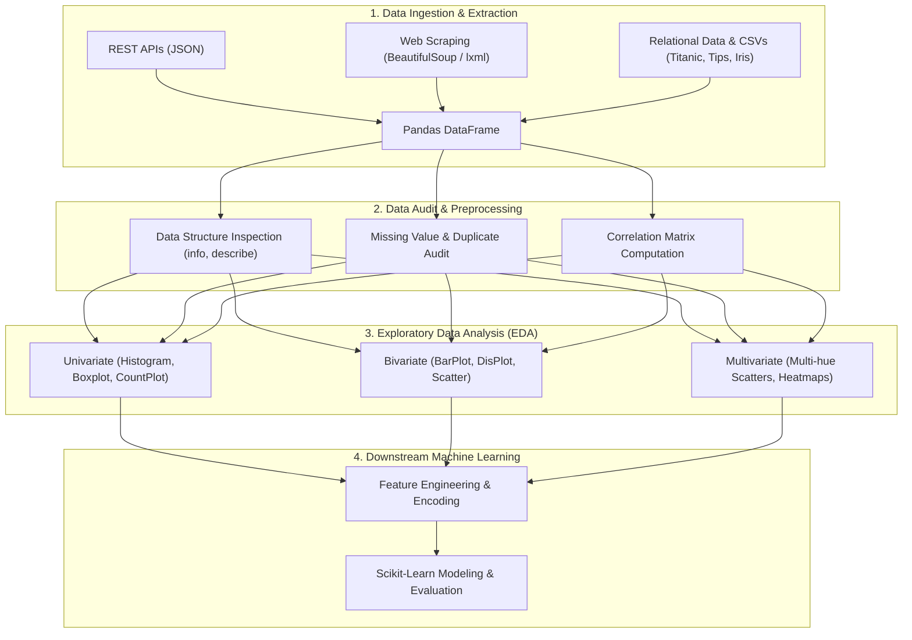

<div align="center">

# 🚀 Machine Learning & Data Science Toolkit

**An end-to-end practical toolkit covering Data Extraction, Web Scraping, Exploratory Data Analysis (EDA), and Statistical Data Visualization.**

[](https://www.python.org/)
[](https://jupyter.org/)
[](https://pandas.pydata.org/)
[](https://numpy.org/)
[](https://scikit-learn.org/)
[](https://seaborn.pydata.org/)
[](https://colab.research.google.com/drive/1WGsMmVHeuBpGiZp5QY--dkRqd0LQpAOo)
[](https://opensource.org/licenses/MIT)

[Explore Features](#-key-features) •
[Pipeline Architecture](#-pipeline-architecture) •
[Installation](#-getting-started) •
[Usage](#-usage-guide) •
[EDA & Visualizations](#-exploratory-data-analysis--visualizations) •
[Roadmap](#-future-roadmap)

</div>

---

## 📌 Overview

This repository serves as a hands-on foundation for modern **Data Science** and **Machine Learning** workflows. It bridges the gap between raw data collection and machine-learning-ready datasets through robust ingestion methods, thorough statistical profiling, and multi-dimensional visual exploration.

Whether fetching live financial data from public REST APIs, scraping corporate metrics with BeautifulSoup, or uncovering non-linear patterns in classic datasets (Titanic, Tips, Iris), this project provides reusable and modular code patterns.

---

## ⚡ Key Features

- **🌐 Multi-Source Data Ingestion**:
  - Live **REST API** consumption and JSON parsing with Pandas (`pd.read_json`).
  - Robust **Web Scraping** pipeline using `requests` and `BeautifulSoup` with user-agent spoofing, fallback mechanisms, and HTML parsing via `lxml`.
  - Structured file reading (CSV, SQL interfaces) with column filtering and memory optimization.

- **🔍 Comprehensive Data Profiling**:
  - Structural auditing (`df.info()`, `df.describe()`, `df.shape`).
  - Missing value detection (`df.isnull().sum()`) and duplicate auditing (`df.duplicated().sum()`).
  - Correlation matrices (`df.corr()`) for initial feature relationship mapping.

- **📊 Advanced Statistical Visualization**:
  - **Univariate Analysis**: Categorical distributions (Count plots, Pie charts) & Numerical distributions (Histograms with custom binning, Boxplots for 5-number summary).
  - **Bivariate & Multivariate Analysis**:
    - Scatter plots with multi-variable dimensional encoding (`hue`, `style`, `size`).
    - Aggregated comparative bar plots with error estimation.
    - Segmented boxplots and distribution plots (`sns.displot` / KDE) across target classes.
    - Categorical correlation via heatmaps and cross-tabulations.

- **💻 Flexible Execution Modes**:
  - Available as both a fully documented **Jupyter / Colab Notebook** (`ml_sklearn.ipynb`) and a clean, executable **Python Script** (`ml_sklearn.py`).

---

## 🛠️ Pipeline Architecture

The data pipeline flows through four sequential stages:



---

## 📂 Project Structure

```bash
machine_learning-/
├── ml_sklearn.ipynb    # Interactive notebook with outputs & Colab integration
├── ml_sklearn.py       # Standalone executable script version of the workflows
├── Titanic-Dataset.csv # Benchmark dataset used for classification & survival EDA
├── README.md           # Project documentation and guide
└── requirements.txt    # Python dependencies and version specs
```

---

## 🚀 Getting Started

### Prerequisites

Ensure you have **Python 3.8+** installed on your system.

### 1. Clone the Repository

```bash
git clone https://github.com/pushpendram988/machine_learning-.git
cd machine_learning-
```

### 2. Create a Virtual Environment

```bash
# macOS/Linux
python3 -m venv venv
source venv/bin/activate

# Windows
python -m venv venv
venv\Scripts\activate
```

### 3. Install Dependencies

Install the core data science and machine learning packages:

```bash
pip install -r requirements.txt
```

*(Or install directly via pip)*:
```bash
pip install numpy pandas requests beautifulsoup4 lxml matplotlib seaborn scikit-learn jupyter
```

---

## 📖 Usage Guide

### Running Interactively via Jupyter Notebook

Launch Jupyter Notebook or JupyterLab:

```bash
jupyter notebook ml_sklearn.ipynb
```

> **Tip:** You can also run this notebook directly in the cloud using Google Colab by clicking the badge at the top of this README.

### Running via Python Script

Execute the standalone script directly from your terminal:

```bash
python ml_sklearn.py
```

---

## 🔬 Exploratory Data Analysis & Visualizations

Here is a breakdown of the visualization techniques and statistical methods implemented:

| Technique | Function / Tool | Purpose | Example Dataset |
| :--- | :--- | :--- | :--- |
| **API Ingestion** | `pd.read_json()` | Ingest dynamic currency/exchange rates directly into DataFrame | ExchangeRate API |
| **Web Scraping** | `requests` + `BeautifulSoup` | Parse DOM tree, extract company names, ratings, and reviews | AmbitionBox |
| **Frequency Analysis** | `value_counts().plot(kind='bar')` | Assess class balance across target categories | Titanic (`Survived`, `Pclass`) |
| **Proportion Breakdown** | `plot(kind='pie', autopct='%.2f')` | Visualize class share percentages | Titanic (`Pclass`) |
| **Spread & Distribution** | `plt.hist(bins=40)` / `sns.displot()` | Inspect skewness, kurtosis, and age distributions | Titanic (`Age`) |
| **5-Number Summary** | `sns.boxplot()` | Identify outliers, median, and IQR bounds | Titanic (`Fare`, `Age`) |
| **Multivariate Scatter** | `sns.scatterplot(hue, style, size)` | 5-variable relationship exploration in a single 2D plot | Tips (`total_bill` vs `tip`) |
| **Aggregated Comparisons** | `sns.barplot(x, y, hue)` | Compare mean metric values with confidence intervals across groups | Titanic (`Pclass` vs `Fare` / `Age`) |
| **Correlation & Co-occurrence**| `sns.heatmap()` | Uncover inter-feature correlation and categorical interactions | Titanic / Tips |

---

## 💡 Code Snippets

<details>
<summary><b>Click to expand: Web Scraping Pipeline with BeautifulSoup</b></summary>

```python
import requests
from bs4 import BeautifulSoup
import pandas as pd

url = 'https://www.ambitionbox.com/list-of-companies?page=1'
headers = {
    'User-Agent': 'Mozilla/5.0 (Windows NT 10.0; Win64; x64) AppleWebKit/537.36'
}

response = requests.get(url, headers=headers, timeout=15)
soup = BeautifulSoup(response.text, 'html.parser')

companies, ratings, reviews = [], [], []

for card in soup.find_all('div', class_='companyCardWrapper'):
    name = card.find('h2', class_='companyCardWrapper__companyName')
    rating = card.find('span', class_='companyCardWrapper__companyRatingValue')
    review = card.find('span', class_='companyCardWrapper__ActionCount')

    if name:
        companies.append(name.text.strip())
        ratings.append(rating.text.strip() if rating else "N/A")
        reviews.append(review.text.strip() if review else "N/A")

df = pd.DataFrame({'Company': companies, 'Rating': ratings, 'Reviews': reviews})
print(df.head())
```

</details>

<details>
<summary><b>Click to expand: Multivariate Statistical Plotting with Seaborn</b></summary>

```python
import seaborn as sns
import matplotlib.pyplot as plt

tips = sns.load_dataset('tips')

# 5-dimensional multivariate visualization:
# X: total_bill, Y: tip, Color (Hue): sex, Marker (Style): smoker, Size: party size
plt.figure(figsize=(10, 6))
sns.scatterplot(
    x=tips['total_bill'],
    y=tips['tip'],
    hue=tips['sex'],
    style=tips['smoker'],
    size=tips['size'],
    sizes=(20, 200),
    palette='viridis'
)
plt.title('Multivariate Bill vs. Tip Analysis', fontsize=14)
plt.xlabel('Total Bill ($)')
plt.ylabel('Tip ($)')
plt.show()
```

</details>

---

## 🗺️ Future Roadmap

- [ ] **Data Cleaning Pipelines**: Automated missing-value imputation (SimpleImputer, KNNImputer) and outlier clipping.
- [ ] **Feature Engineering**: One-Hot Encoding, Ordinal Encoding, and ColumnTransformers with Scikit-Learn.
- [ ] **Model Building**: Supervised classification (Logistic Regression, Decision Trees, Random Forest, XGBoost) on Titanic survival.
- [ ] **Model Evaluation**: ROC-AUC curves, Precision-Recall trade-offs, and Confusion Matrix heatmaps.
- [ ] **Interactive Web App**: Streamlit or Gradio dashboard for interactive dataset exploration and real-time predictions.

---

## 🤝 Contributing

Contributions, issues, and feature requests are welcome!

1. Fork the Project (`git checkout -b feature/AmazingFeature`)
2. Commit your Changes (`git commit -m 'Add some AmazingFeature'`)
3. Push to the Branch (`git push origin feature/AmazingFeature`)
4. Open a Pull Request

---

## 📄 License

This project is open-source and available under the [MIT License](LICENSE).

---

<div align="center">

Made with ❤️ by [Pushpendra Mishra](https://github.com/pushpendram988)

⭐ *If you found this project helpful, please consider starring the repository!* ⭐

</div>
